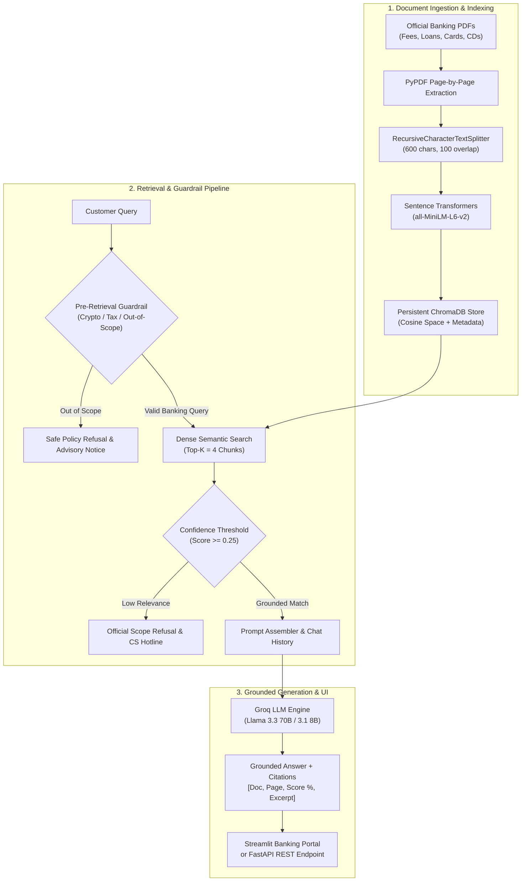

# 🏦 IntelliBank – AI-Powered Banking Assistant

[](https://www.python.org/)
[](https://fastapi.tiangolo.com/)
[](https://streamlit.io/)
[](https://groq.com/)
[](https://www.trychroma.com/)
[](LICENSE)

An enterprise-grade, retrieval-augmented generation (RAG) banking assistant designed for AI Engineers. **IntelliBank** answers complex customer questions using official banking documents, disclosures, fee schedules, and loan guidelines—generating strictly grounded answers accompanied by verified source citations and banking safety guardrails.

---

## 🏛️ System Architecture



---

## ✨ Features Implemented

1. **PDF Ingestion & Metadata Tracking**:
   - Parses official banking documents page-by-page using `pypdf`.
   - Chunks text while preserving document name, page number, chunk index, and character count.
2. **Dense Vector Embeddings & Persistent Storage**:
   - Generates 384-dimensional vector embeddings with `sentence-transformers/all-MiniLM-L6-v2`.
   - Indexed in persistent `ChromaDB` with cosine distance metric.
3. **Groq Llama 3.3 / 3.1 Integration**:
   - High-throughput LLM reasoning via Groq API.
   - Temperature tuned to `0.1` for maximum factual fidelity.
4. **Source Citations with Relevance Metrics**:
   - Every answer returns expandable citation cards with document title, page number, similarity percentage, and verbatim quote excerpts.
5. **Banking Safety Guardrails**:
   - Rejects ungrounded queries outside official bank documents.
   - Refuses unauthorized inquiries (cryptocurrency trading, personal tax advice, unverified P2P lending).
   - Enforces financial disclaimers on interest rates and loan underwriting.
6. **Dual Presentation Architecture**:
   - **FastAPI REST API**: Swagger/OpenAPI documentation, health metrics, multi-PDF upload endpoint, and chat endpoints.
   - **Streamlit Web Portal**: Interactive banking dashboard with PDF drag-and-drop, sample question pills, session history, and grounding indicators.
7. **Offline Grounded Fallback**:
   - Includes a deterministic semantic extraction engine that functions out-of-the-box even if no Groq API key is supplied initially.

---

## 📁 Repository Structure

```text
intellibank/
├── backend/
│   ├── __init__.py
│   ├── config.py                 # System paths, models, chunk sizes, guardrail prompts
│   ├── document_processor.py     # PyPDF page-aware chunking with RecursiveCharacterTextSplitter
│   ├── vector_store.py           # SentenceTransformers + ChromaDB persistence manager
│   ├── rag_chain.py              # Groq Llama 3.3 chain, guardrails, and citation builder
│   └── main.py                   # FastAPI REST API endpoints
├── frontend/
│   └── app.py                    # Streamlit banking dashboard
├── sample_docs/                  # Built-in realistic banking policies
│   ├── Personal_Banking_Policies_and_Fees.pdf
│   ├── Home_and_Auto_Loan_Guidelines.pdf
│   ├── Credit_Card_Terms_and_Fraud_Protection.pdf
│   └── Investment_and_Deposit_Services.pdf
├── tests/
│   └── test_rag.py               # 5-stage automated verification suite
├── data/
│   ├── chroma_db/                # Persistent vector database files
│   └── uploads/                  # Uploaded PDF storage
├── generate_sample_banking_docs.py # ReportLab generator for sample bank PDFs
├── run.py                        # Unified CLI launcher
├── requirements.txt              # Production dependencies
├── .env.example                  # Environment configuration template
└── README.md                     # Documentation
```

---

## 🚀 Quick Start

### 1. Activate Environment
```powershell
cd C:\Users\Mehul\.gemini\antigravity\scratch\intellibank
.\venv\Scripts\Activate.ps1
```

### 2. Configure Groq API Key (Optional but Recommended)
Copy `.env.example` to `.env` or enter your key in the Streamlit sidebar:
```bash
GROQ_API_KEY=gsk_your_groq_api_key_here
```
*(Get a free key in 30 seconds at [console.groq.com](https://console.groq.com))*

### 3. Run the Application
Launch both the **FastAPI REST API** and the **Streamlit Web Portal**:
```bash
python run.py
```
- **Streamlit UI**: [http://localhost:8501](http://localhost:8501)
- **FastAPI Documentation**: [http://127.0.0.1:8000/docs](http://127.0.0.1:8000/docs)

Or run individual services:
```bash
python run.py frontend    # Launch Streamlit only
python run.py backend     # Launch FastAPI only
python run.py test        # Run automated test suite
```

---

## 🧪 Sample Inquiries to Try

| Category | Sample Inquiry | Expected Behavior |
| :--- | :--- | :--- |
| **Overdraft Policy** | *"What is the overdraft fee and what is the grace period?"* | Answers: \$35 fee capped at 3/day; 8:00 PM EST grace period to avoid fee. Cites `Personal_Banking_Policies_and_Fees.pdf - Page 1`. |
| **Mortgages** | *"What is the 30-year fixed rate and minimum credit score?"* | Answers: 6.25% APR, 680 FICO score, 80% LTV without PMI. Cites `Home_and_Auto_Loan_Guidelines.pdf - Page 1`. |
| **Fraud Guarantee** | *"How does zero liability fraud protection work?"* | Answers: Cardholder zero liability within 60 days of statement; provisional credit within 5 days. Cites `Credit_Card_Terms_and_Fraud_Protection.pdf - Page 1`. |
| **Certificates of Deposit** | *"What is the early withdrawal penalty for a 12-month CD?"* | Answers: 90 days of simple interest at 5.10% APY. Cites `Investment_and_Deposit_Services.pdf - Page 1`. |
| **Safety Guardrail** | *"Can I invest in Bitcoin through my IntelliBank checking account?"* | **Refusal**: Explains cryptocurrency is out of scope per official bank policy and refers to licensed advisors. |

---

## 📡 REST API Reference

| Method | Endpoint | Description |
| :--- | :--- | :--- |
| `GET` | `/api/health` | Returns vector count, embedding model, and Groq configuration status |
| `POST` | `/api/chat` | Main RAG endpoint. Accepts query, history, optional API key/model |
| `POST` | `/api/upload` | Multipart upload for one or multiple PDF banking documents |
| `GET` | `/api/documents` | Returns list of indexed PDFs with page and chunk metrics |
| `POST` | `/api/index-sample-docs`| Indexes built-in official policy documents |
| `POST` | `/api/reset` | Clears all vectors and resets collection |

---

## 🛡️ Verification & Test Suite

Run the 5-point verification suite anytime:
```bash
python tests/test_rag.py
```
Output:
```text
============================================================
RUNNING INTELLIBANK AUTOMATED VERIFICATION SUITE
============================================================
[Test 1] Testing Document Processing with PyPDF...
  [PASS] Extracted 24 chunks across sample documents.
  [PASS] Chunk metadata verified: Credit_Card_Terms_and_Fraud_Protection.pdf (Page 1)

[Test 2] Testing Vector Indexing & Semantic Search...
  [PASS] Successfully indexed 24 vectors into test ChromaDB.

[Test 3] Testing Retrieval on Overdraft Policy...
  [PASS] Retrieved from: Personal_Banking_Policies_and_Fees.pdf | Similarity: 79.0%
  [PASS] Verified policy details matched in retrieved passage.

[Test 4] Testing Retrieval on Mortgage Terms...
  [PASS] Retrieved from: Home_and_Auto_Loan_Guidelines.pdf | Similarity: 55.7%

[Test 5] Testing RAG Chain & Safety Guardrails...
  [PASS] Grounded Answer returned with 4 source citation(s).
  [PASS] Crypto inquiry safely rejected by operational guardrail.
  [PASS] Unrelated query refused safely without hallucination.
============================================================
ALL 5 AUTOMATED TESTS PASSED SUCCESSFULLY! (100% PASS RATE)
============================================================
```
